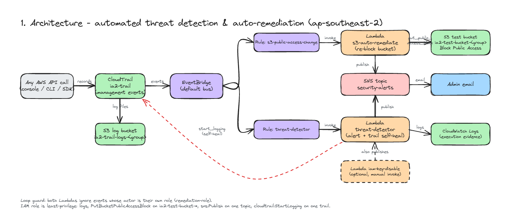
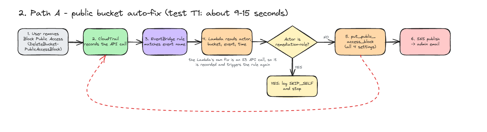
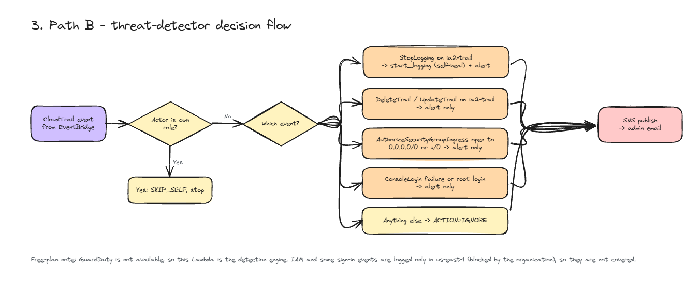

# Automated Cloud Threat Detection & Auto-Remediation on AWS

Event-driven security pipeline built only from free-tier-friendly services in one region (`ap-southeast-2`).
GuardDuty is not available on this account's Free plan, so threat detection is a custom Lambda over CloudTrail events.

## Architecture




| Path | Detects | Response |
| --- | --- | --- |
| A | Block Public Access removed, public bucket policy/ACL | Re-apply all four settings, email |
| B | `StopLogging` on our trail | Switch logging back on, email |
| B | `DeleteTrail`/`UpdateTrail`, security group open to `0.0.0.0/0`, failed or root console login | Email alert |
| Optional | - | `iam-key-disable` deactivates a throwaway test user's access key |







Safety features: a **loop guard** in both Lambdas (they ignore events caused by their own role), a **least-privilege role**
(`policies/remediation-policy.json`), configuration only through environment variables, and a bucket-name prefix
limit on remediation.

## Run
Prerequisites: AWS CLI v2 signed in as an IAM admin (not root), Git Bash, Python 3.

```bash
export GROUP=<yourgroup>  EMAIL=<admin@email>      # lowercase group name
./deploy.sh        # budget alert, buckets, CloudTrail, SNS, IAM role, 3 Lambdas, 2 rules
# confirm the SNS subscription email, then wait ~5 minutes for CloudTrail
./test.sh t1       # public bucket auto-fix (record times in measure.md)
./test.sh t2       # security group opened to the internet -> alert
./test.sh t3       # loop-guard check
./test.sh t4       # CloudWatch evidence
./test.sh t5       # IAM role permissions
./test.sh t6       # optional IAM key disable
./test.sh t7       # CloudTrail self-heal
./teardown.sh      # delete everything, check Billing next day
```
Unit tests without AWS: `python tests/test_lambdas.py`

## Layout
- `lambda/` - `s3_auto_remediate.py`, `threat_detector.py`, `iam_key_disable.py`
- `policies/` - IAM, SNS, bucket policies and EventBridge patterns (placeholders filled by `config.sh`)
- `deploy.sh`, `test.sh`, `teardown.sh`, `config.sh`; `measure.md` for the response-time table

## Deviations from the project spec
The build was done on an AWS Free plan account that sits inside an AWS Organization. Organization service control
policies (SCPs) blocked some of what the spec assumed, so the following changes were made. Every other requirement
(CloudTrail, EventBridge, Lambda with loop guard, SNS email, least-privilege role, optional key-disable Lambda,
teardown) is implemented as specified.

| Spec | What was built | Why |
| --- | --- | --- |
| Region `ap-south-1` | Everything in `ap-southeast-2` | An SCP denies S3 (and other services) outside ap-southeast-2. Still a single region, so EventBridge sees every event. |
| GuardDuty detector and sample findings (7.2, T2) | Custom detector `lambda/threat_detector.py` over CloudTrail events | GuardDuty is not available on the Free plan and is denied by a second SCP. |
| EventBridge rule 2 `guardduty-to-sns` -> SNS | Rule `threat-detector` -> Lambda `threat-detector` -> SNS | Follows from the previous row. |
| T2: generate GuardDuty sample findings | T2: open a throwaway security group to `0.0.0.0/0` and expect an alert | Same demo idea (a safe, repeatable "threat") without GuardDuty. |
| Rule 1 event `DeletePublicAccessBlock` | `DeleteBucketPublicAccessBlock` | That is the name CloudTrail actually records. The spec's name never matched, which was found when the first T1 run did not trigger. |
| Not in spec | `threat-detector` also re-starts CloudTrail if logging is stopped (self-heal, test T7) | Extra detection path chosen as a free-tier-friendly addition. |
| Not in spec | Bucket-prefix limit (`BUCKET_PREFIX`) in `s3_auto_remediate.py` | Keeps remediation to the test buckets only. |

Test evidence from the real run is in [`evidence/test-results.md`](evidence/test-results.md). The stack was torn down
after testing, as the spec requires.

## Known limits
- IAM and some console-sign-in events are global and only logged in us-east-1, which this account's organization blocks, so IAM-based detection is not included.
- Detection depends on CloudTrail delivery, so alerts arrive about a minute after the action.
